# Atelier for ES-DE

  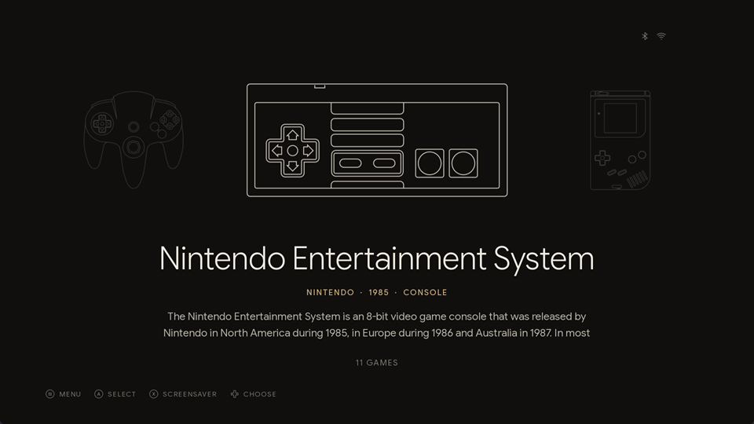

   
  <strong>❤️ Support this project</strong>
    
  If you enjoy this project, consider supporting its development with a donation.
    
  
    

**A quiet, modern theme for [ES-DE](https://es-de.org).** Atelier treats your game library the way a good book treats its pages: generous margins, careful type, and nothing on screen that doesn't need to be there. Systems are introduced by fine line drawings of their controllers, game lists read like the index of a book, and a single warm accent marks whatever deserves your attention. Everything is set in Google Sans Flex, with tracked capitals for the small labels.

It comes with a few companions too: collections that sort your games by the year they came out, and a RetroAchievements app that looks like it was always part of ES-DE.

**ES-DE 3.0 or newer** · 5 layouts · 8 color schemes · 4 screen shapes · 23 languages · controller drawings for 200 systems and collections · a RetroAchievements app

**Contents:** [Highlights](#highlights) · [The system view](#the-system-view) · [Layouts](#layouts) · [Color schemes](#color-schemes) · [File name tags](#file-name-tags) · [Year collections](#year-collections) · [RetroAchievements](#retroachievements) · [Every screen](#every-screen) · [Languages](#languages) · [Sounds](#sounds) · [Settings](#settings) · [Installation](#installation) · [Tips](#tips) · [Credits](#credits)

## Highlights

- **Five layouts:** Index, with or without videos, Typographic, Gallery and Grid, each drawn by hand for 21:9, 16:9, 16:10 and 4:3
- **Eight color schemes:** Noir, Ivory, Midnight and OLED, each also in an *atmosphere* version that takes on the color of the console
- **File name tags:** region, languages and revision, read straight from your ROM file names and shown as small tags, with nothing to scrape
- **Year collections:** one collection per release year, the games grouped by platform, with covers that name their console like the spine of a box
- **RetroAchievements:** an app in the same design, opened from the system carousel, with your progress, your badges and a gentle nudge toward the next achievement; your progress can show up in ES-DE's game details too
- **A clean Collections system:** a page of its own for your custom collections, without random games or videos playing
- **Soft navigation sounds**, tuned to each other
- **23 languages** for labels and system descriptions
- **Graceful without scraping:** systems with no media switch to a purely typographic page, so even an empty library looks intentional

Developed and tested on ES-DE 3.5.

## The system view

Every system gets a proper introduction. Its controller sits large in the middle of the carousel, drawn in a single fine line, with its neighbors dimmed on either side. Beneath it you'll find the name of the system, a caption with its maker, year and kind (*Nintendo · 1990 · Console*), a few lines of its history and the number of games you have. With the *soft* transitions the text fades while the drawings slide on.

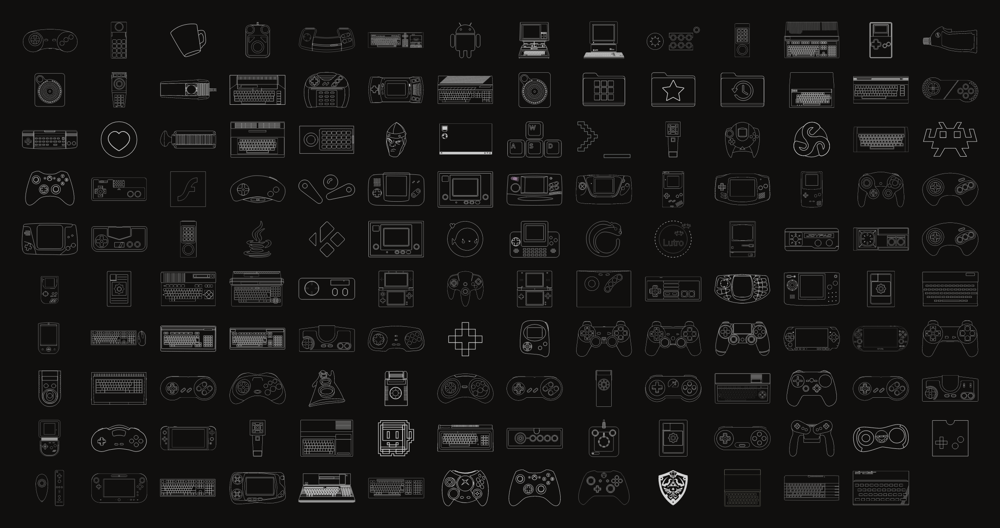

The drawings come from ES-DE's own outline set and cover nearly every system it knows, from the Atari 2600 to the Switch, collections included; the few without one get a neutral folder. When several systems share a drawing, such as the Amiga models, the CD and regional versions of a console or the many arcade boards, a small tag in the corner names the model (*AMIGA 1200*, *MEGA-CD*, *NAOMI 2*), so no two systems in the carousel look alike. The same drawing follows you into the header of the game list.

## Layouts

Five ways to browse your games, all sharing the same calm grid. Pick one under *UI settings → Theme variant*.

### Index

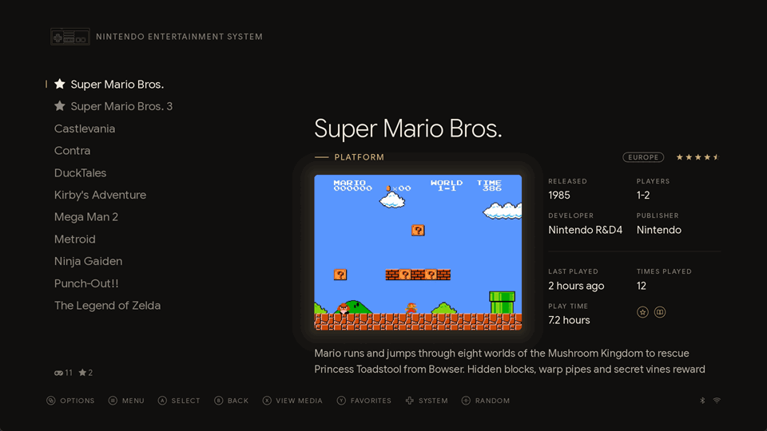

The classic: your game list beside a rounded media card lit by a soft glow, where the screenshot gently gives way to the game video, with the facts and your play statistics alongside. *Index, no videos* keeps the still image, if you prefer a quieter screen.

### Typographic

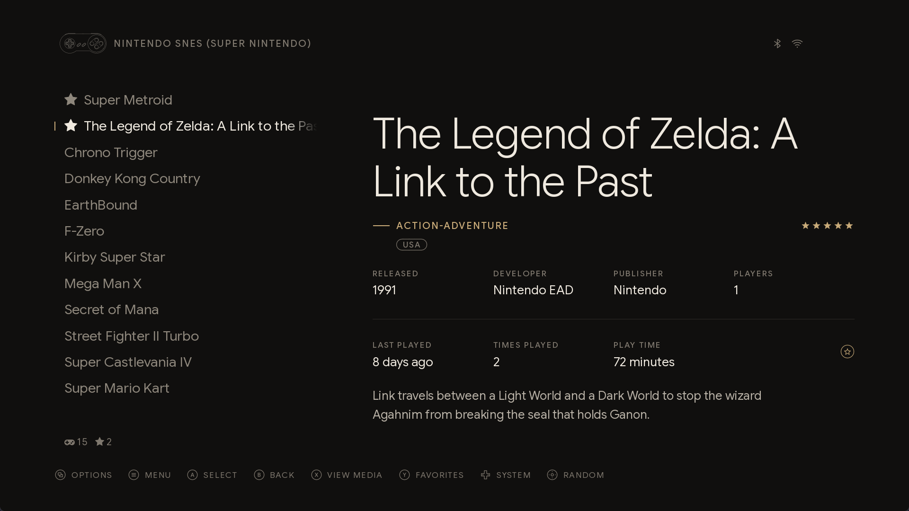

No media at all: the title carries the page. The Index layouts switch to it on their own for systems you haven't scraped yet, so an unscraped library still looks deliberate rather than empty. *Enable theme variant triggers* in the UI settings turns this off.

### Gallery

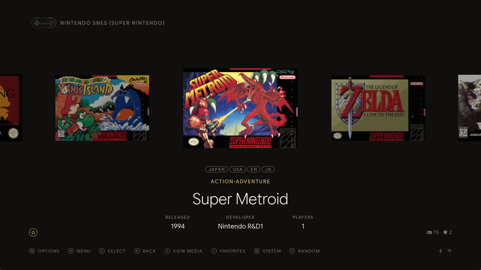

A shelf of box covers with the selected title set beneath it, sized for the shape of each console's boxes. Games without a cover still get one, made of type.

### Grid

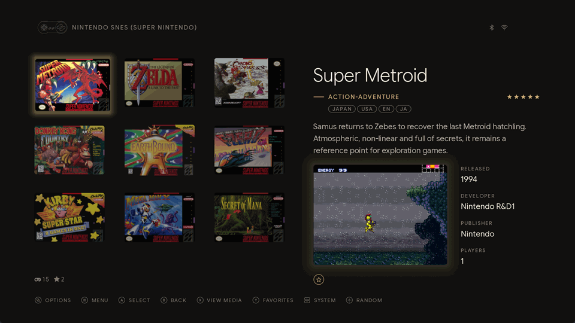

Box covers in rows across the left of the page, and beside them the title, genre and description, then the media card with the facts. The selected cover is lit by the same glow as the media card.

## Color schemes

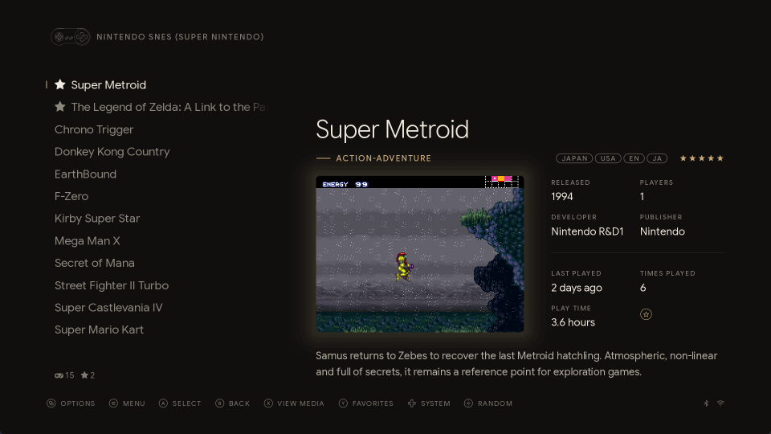

| Scheme | Page | Accent | Feel |
| :-- | :-- | :-- | :-- |
| **Noir** | warm black | champagne | the default, soft and warm |
| **Ivory** | paper | bronze ink | a printed page; the glows become soft shadows |
| **Midnight** | deep navy | gold | cool and calm |
| **OLED** | true black | champagne | for OLED screens, nothing lit that needn't be |

Pick one under *UI settings → Theme color scheme*.

### Atmosphere

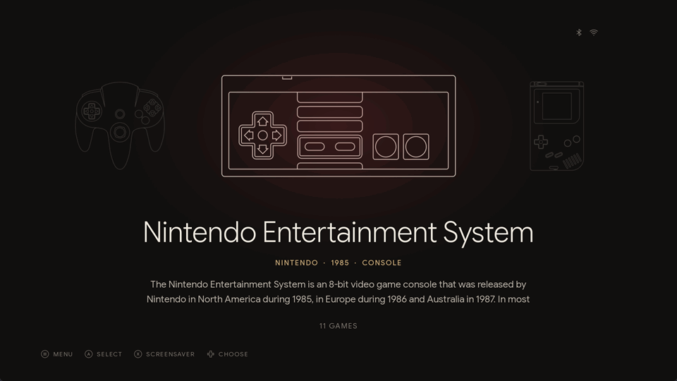

Each scheme also comes in an *atmosphere* version, for evenings when you want a little more mood. A soft room light in the color of the console glows behind its drawing, the light around the game media and the selected cover takes the same color, and the game lists rest on a faint, desaturated copy of the selected game's fanart (or screenshot).

## File name tags

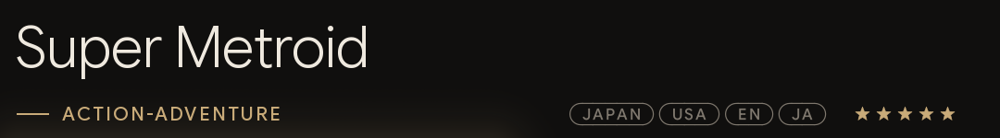

ROM sets keep useful details in brackets in the file name: region, languages, revision, disc, dump flags. Atelier shows each of them as a small tag beside the rating, so `Super Metroid (Japan, USA) (En,Ja).sfc` reads JAPAN · USA · EN · JA. Parts in parentheses get rounded tags, parts in square brackets such as `[!]` square ones, and a file without any shows nothing. There is nothing to scrape or set up.

How does a theme pull that off? ES-DE only hands it the file name as a whole, so the tags are drawn by a font of their own. Every character in it is an empty glyph by default, and contextual substitutions, which ES-DE applies while laying out the text, make a bracket start a tag, keep the characters after it visible and split the tag at each comma.

## Year collections

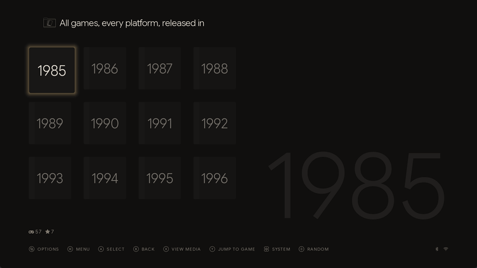

Ever wanted to see everything you own from 1993, whatever it runs on? Atelier gives ES-DE's grouped *Collections* system a page of its own, and two small scripts fill it with one collection per year.

The list of collections stays clean, without a random game, its description or the sound of its video: a heading such as "All games, every platform, released in" is completed by the selected year, set large and faint behind the list. Inside a collection the header shows its name, with the platform of the selected game beneath it, and game videos play without sound. With collections sorted by platform, each year reads like a page with the games grouped by console.

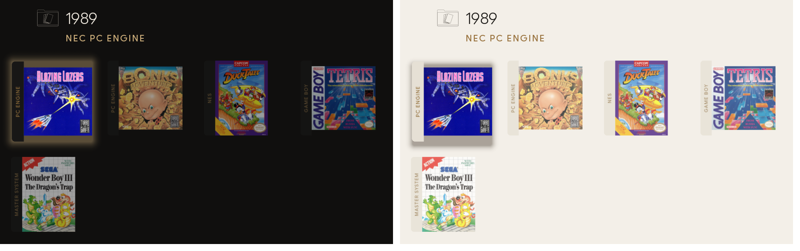

The scripts also give every game in the *Collections* system a cover with a band down its left side naming its platform, the way a box spine does, so a year that mixes consoles tells you at a glance where each game comes from. The band is drawn by the theme in the colors of the active scheme, dark on Noir, Midnight and OLED and light on Ivory, so it follows you when you change scheme; in Gallery the name stands beside the cover instead.

The scripts are in the theme's `scripts/runnable` folder. They need [Node.js](https://nodejs.org), and ES-DE should be closed while they run.

- **Update year collections.cmd** creates the collections and the banners, and enables the collections. Run it again after scraping new games. Every year is enabled again, including any you turned off in the ES-DE menu. With *Group custom collections* set to *If unthemed* or *Always*, the years appear inside the *Collections* system. The first time, it downloads the small image library it draws the banners with ([resvg-js](https://github.com/yisibl/resvg-js)), so it needs an internet connection once.
- **Remove year collections.cmd** deletes the collections and the banners again, and puts your own miximages back.

What the scripts change

Besides the collections and the list of enabled collections in the settings, the scripts write one field per game in the gamelists: the collection sort name, which ES-DE only uses inside custom collections. Each gamelist is backed up once as `gamelist.xml.atelier-backup`. ES-DE draws a grid tile from a single game image, so the banner has to be part of the picture: the covers with the band are stored as the games' miximages, which Atelier uses for nothing else, and any miximage you already had is kept in `ES-DE/atelier/miximages-backup` until the banners are removed. On Linux and macOS, run `npm install` in the `scripts` folder once, then `node scripts/year-collections.js` (with `--remove` to delete everything).

## RetroAchievements

If you hunt achievements on [RetroAchievements](https://retroachievements.org), Atelier gives you a trophy room that feels like part of ES-DE. Pick *RetroAchievements* in the system carousel (it comes after your systems) and every game you own that has achievements is there: how far you've come, which badges you've earned, and which one you're most likely to earn next. Press B and you're back in ES-DE, right where you left it.

The app wears the theme you chose: the same color scheme, font size, aspect ratio, sounds and help icons. It works with a controller or the keyboard, and every time it opens it fetches your latest unlocks, so after a play session the new badges are waiting for you. When the site can't be reached, it shows what it saw last.

### Your library

Your games sit on one shelf of covers per platform, with a progress bar under each cover. Games you're in the middle of get a shelf of their own at the top, *Continue playing*, so picking up where you left off is one button away. Above the shelves, a bar shows how far you've come overall; switch the filter and it shows the progress of just those games.

Beside the shelves, the selected game tells its story: achievements and points earned, your play time and hardcore unlocks as RetroAchievements counts them, and under *Next* the locked achievement most players already have, a good place to start. If your file is a version RetroAchievements doesn't recognize, such as a region or revision other than the supported ones, the app says so and lists the versions it does support, because RetroArch won't unlock anything with it.

### Three ways to look at it

Press **Start** for the options, just as in ES-DE, and choose how the library looks. The change happens behind the menu as you scroll through the choices, and the app remembers it next time.

<table>
  <tr>
    <td>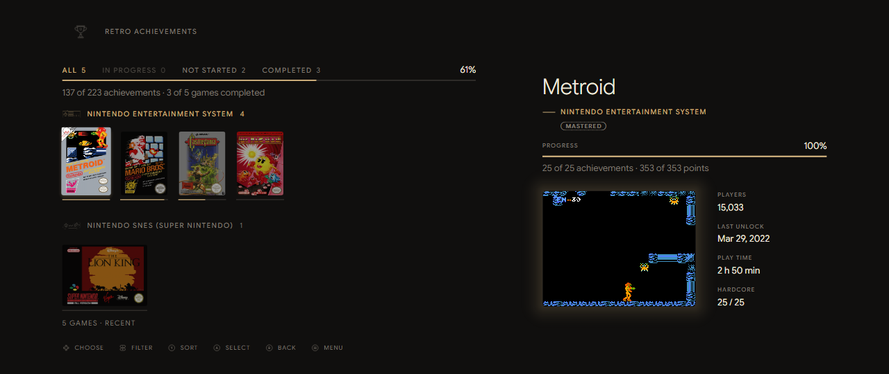</td>
    <td>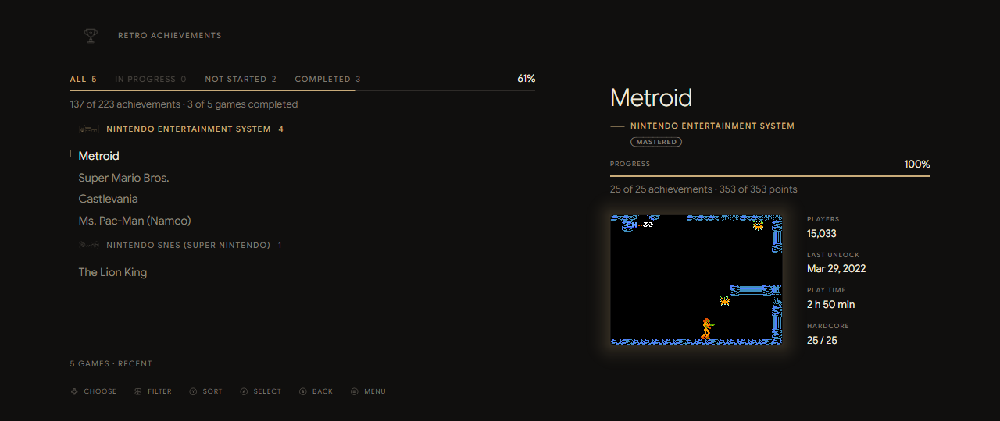</td>
    <td>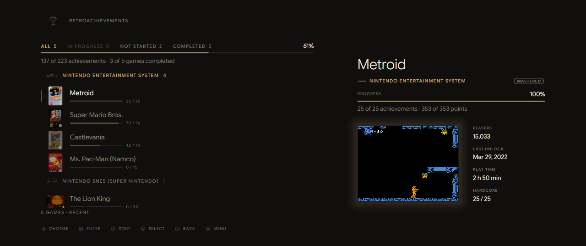</td>
  </tr>
  <tr>
    <td align="center"><b>Grid</b> shelves of covers</td>
    <td align="center"><b>Titles</b> just the names, like a game list</td>
    <td align="center"><b>Titles & cover</b> each name with its box and progress</td>
  </tr>
</table>

The same menu also sorts the library, filters it, and takes you back to ES-DE.

### The wall of badges

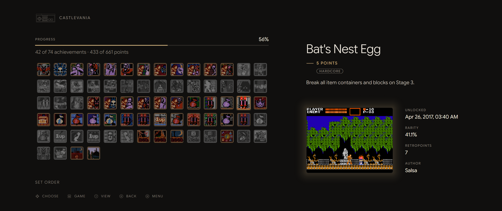

Press **A** on a game and its badges fill the page: the ones you've earned in full color, the rest in grey. For the selected badge you see what it asks of you, its points, when you earned it and how rare it is among players. Press **Y** to see only the badges still to unlock, the most common first, or only the ones you've earned, the latest first.

### Controls

| | Library | Wall of badges |
| :-- | :-- | :-- |
| **D-pad** | move between games | move between badges |
| **A** | open the game's badges | |
| **B** | back to ES-DE | back to the library |
| **LB / RB** | filter: all, in progress, not started, completed | previous / next game on the shelf |
| **Y** | sort: latest unlocks, progress, name | view: set order, still to unlock, unlocked |
| **Start** | options | options |

On a keyboard, as in ES-DE: Enter is A, Backspace is B, Escape is Start, Page Up and Page Down are LB and RB, and the Y key is Y.

### Setting it up

On Windows you need [Node.js](https://nodejs.org) and Microsoft Edge, which comes with Windows.

1. On retroachievements.org, open *Settings* and copy your *Web API Key*.
2. Run **Set up achievements.cmd** in the theme's `scripts/runnable` folder and enter your username and the key. It checks them with the site and adds *RetroAchievements* to the system carousel.
3. Restart ES-DE, and there it is.

You can run **Set up achievements.cmd** again at any time, for example after moving the theme folder; press Enter to keep the saved username and key. **Remove achievements.cmd** takes RetroAchievements out of ES-DE again, together with the progress below, the saved username, key and cache.

### Your progress in ES-DE

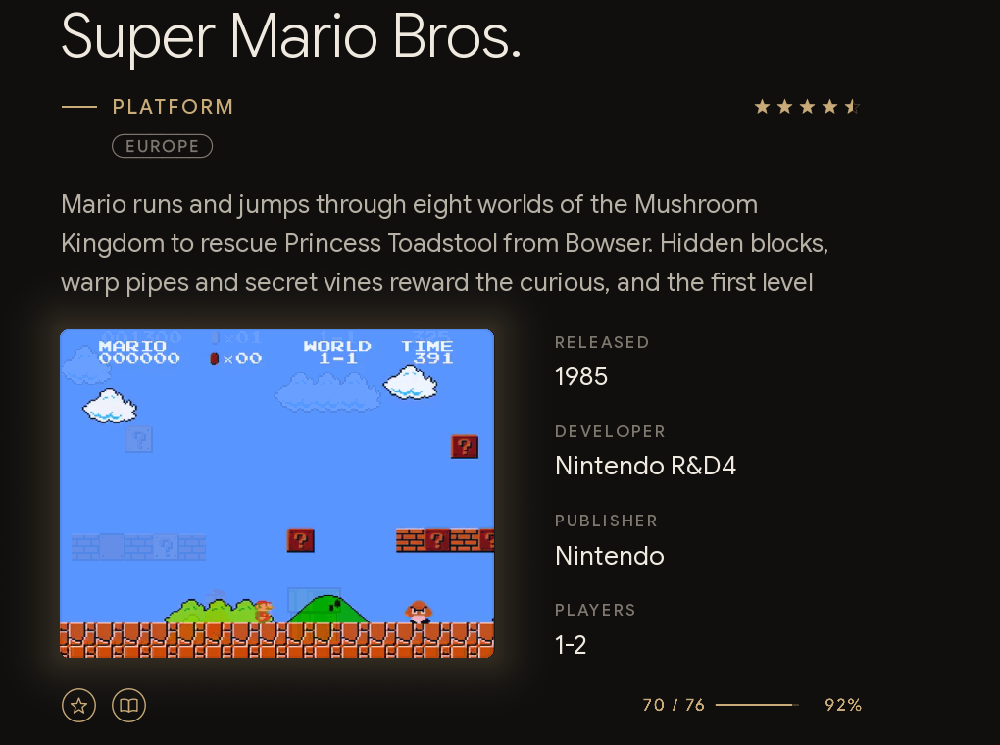

Would you like to see your progress without opening the app? Then let it appear in ES-DE itself, in the details of every game that has achievements: how many you've unlocked out of the total, a slim bar and the percentage, in the accent color of your scheme.

- **Enable achievement progress.cmd** draws it for all your games. From then on the app keeps it up to date each time it opens, and ES-DE shows the new figures after a restart. The first time, it downloads the small image library the year collections use too, so it needs an internet connection once.
- **Disable achievement progress.cmd** removes it again.

ES-DE has no field for this, so the progress is an image that takes the place of each game's physical media image, which Atelier shows nowhere else, and the theme shows it only while the progress is enabled. Your own physical media images, including any you scrape later, wait in `ES-DE/atelier/physicalmedia-backup` and come back when you disable it.

Good to know

- **Your key stays yours.** The username, key and cache live in `ES-DE/atelier/achievements`, outside the theme folder, so updating the theme keeps them and the key never ends up in a copy of the theme. Everything runs on your computer: ES-DE starts a small local server and a full-screen Edge window, which close together.
- **The carousel entry** is added to `ES-DE/custom_systems/es_systems.xml` (a file you already had is backed up once as `es_systems.xml.atelier-backup`), with its game list in `ES-DE/gamelists/retroachievements`.
- **Games are recognized** by the hash of their file, as RetroArch does. Disc images aren't hashed yet, so for those the app goes by the title.
- **Languages:** the app's own words are in English and Italian for now; the rest follows the theme.
- **Linux and macOS:** run `node achievements/setup.js` and `node achievements/remove.js`, and `node achievements/progress.js` (with `--off` to remove the progress). The app needs Microsoft Edge, Google Chrome or Chromium.

## Every screen

<table>
  <tr>
    <td>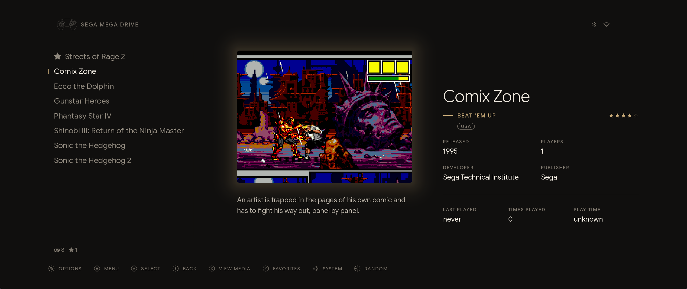</td>
    <td>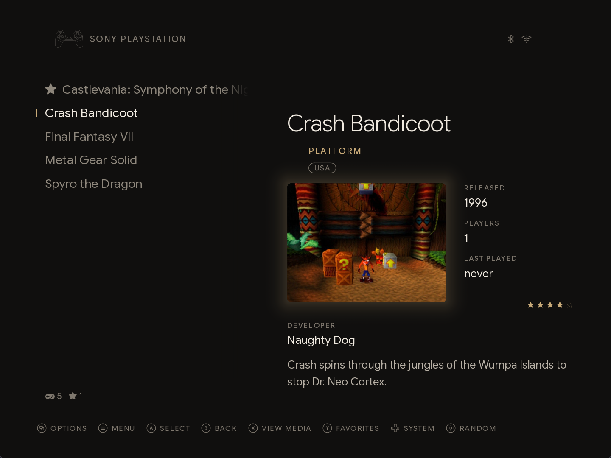</td>
  </tr>
  <tr>
    <td align="center">21:9</td>
    <td align="center">4:3</td>
  </tr>
</table>

Whatever you play on, from an ultrawide monitor to an old 4:3 television, Atelier has a layout drawn for it. Every layout exists for 21:9, 16:9, 16:10 and 4:3, and the right one is picked automatically; *UI settings → Theme aspect ratio* can force one.

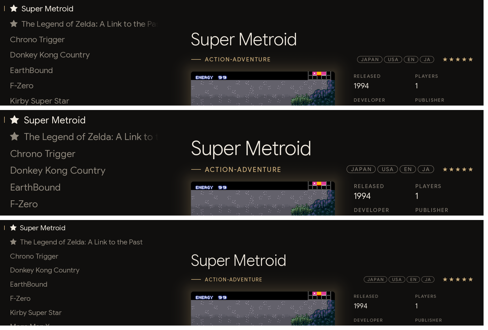

Three font sizes, from the top: **medium**, **large**, for a television seen from the sofa, and **small**, for a monitor at arm's length. Pick one under *UI settings → Theme font size*.

## Languages

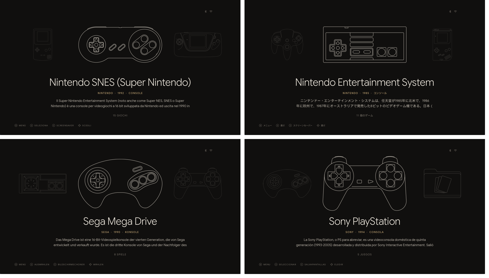

Labels, captions and the history of every system come in 23 languages: English (US and UK), Arabic, Bosnian, Catalan, Chinese (simplified and traditional), Croatian, Dutch, French, German, Italian, Japanese, Korean, Polish, Portuguese (Brazil and Portugal), Romanian, Russian, Serbian, Spanish, Swedish and Vietnamese. Atelier follows the language of ES-DE, or the one chosen under *UI settings → Theme language*.

## Sounds

Seven soft navigation sounds, tuned to one another in E major with a little room around them, replace the ES-DE defaults while *Navigation sounds* is enabled in the sound settings. Have a listen: [scroll](core/sounds/scroll.wav), [system browse](core/sounds/systembrowse.wav), [quick system select](core/sounds/quicksysselect.wav), [select](core/sounds/select.wav), [back](core/sounds/back.wav), [favorite](core/sounds/favorite.wav) and [launch](core/sounds/launch.wav). The RetroAchievements app uses them too.

## Settings

Everything below is in ES-DE's *UI settings* menu.

| Setting | Choices |
| :-- | :-- |
| Theme | Atelier |
| Theme variant | Index · Index, no videos · Typographic · Gallery · Grid |
| Theme color scheme | Noir · Ivory · Midnight · OLED, each also as *· atmosphere* |
| Theme font size | Medium · Large · Small |
| Theme aspect ratio | Automatic · 21:9 · 16:9 · 16:10 · 4:3 |
| Theme transitions | Soft (default) · Slide · Instant |
| Theme language | Automatic, or any of the 23 languages |
| Enable theme variant triggers | On: systems without scraped media use Typographic |

## Installation

Copy the `atelier-es-de` folder into the ES-DE themes directory and select *Atelier* under *UI settings → Theme*:

- Windows portable: `ES-DE\ES-DE\themes\`
- Windows installer, Linux, macOS: `~/ES-DE/themes/`

To update, replace the folder with the new one. If you use RetroAchievements and the folder's name or place changed, run **Set up achievements.cmd** again, and if you show the achievement progress in ES-DE, open the app once so that it comes back.

To uninstall, first run **Remove year collections.cmd** if you used the year collections, so that your own miximages are put back, and **Remove achievements.cmd** if you set up RetroAchievements; then delete the folder.

## Tips

- **Scrape screenshots and covers.** They bring the Index, Gallery and Grid layouts to life: videos fade in over the screenshot when you pause on a game, and fanart feeds the atmosphere schemes. Screenshots are preferred over miximages, as they sit more calmly in the frame.
- **On a television,** choose the *large* font size.
- **For OLED screens,** the *OLED* scheme keeps the page truly black.
- **Keep the file names of your ROM sets.** The tags come straight from them: `(USA, Europe)`, `(Rev 1)`, `(Disc 2)`.
- **After scraping new games,** run *Update year collections.cmd* again, so they get their year and their platform band.
- **Chasing achievements?** Play the versions RetroAchievements supports: the app tells you when a file isn't one of them, and which ones are.

## Credits

The typefaces, controller drawings and system texts are credited in [CREDITS.md](CREDITS.md). Atelier is released under the [MIT license](LICENSE).

The screenshots show box art and game screenshots from the [libretro thumbnail collection](https://github.com/libretro-thumbnails/libretro-thumbnails), and videos and fanart scraped from [ScreenScraper](https://www.screenscraper.fr). The RetroAchievements screenshots show achievement data and badges from [RetroAchievements](https://retroachievements.org). The games and their artwork belong to their respective owners.

   
  <strong>❤️ Support this project</strong>
    
  If you enjoy this project, consider supporting its development with a donation.
    
  
    

